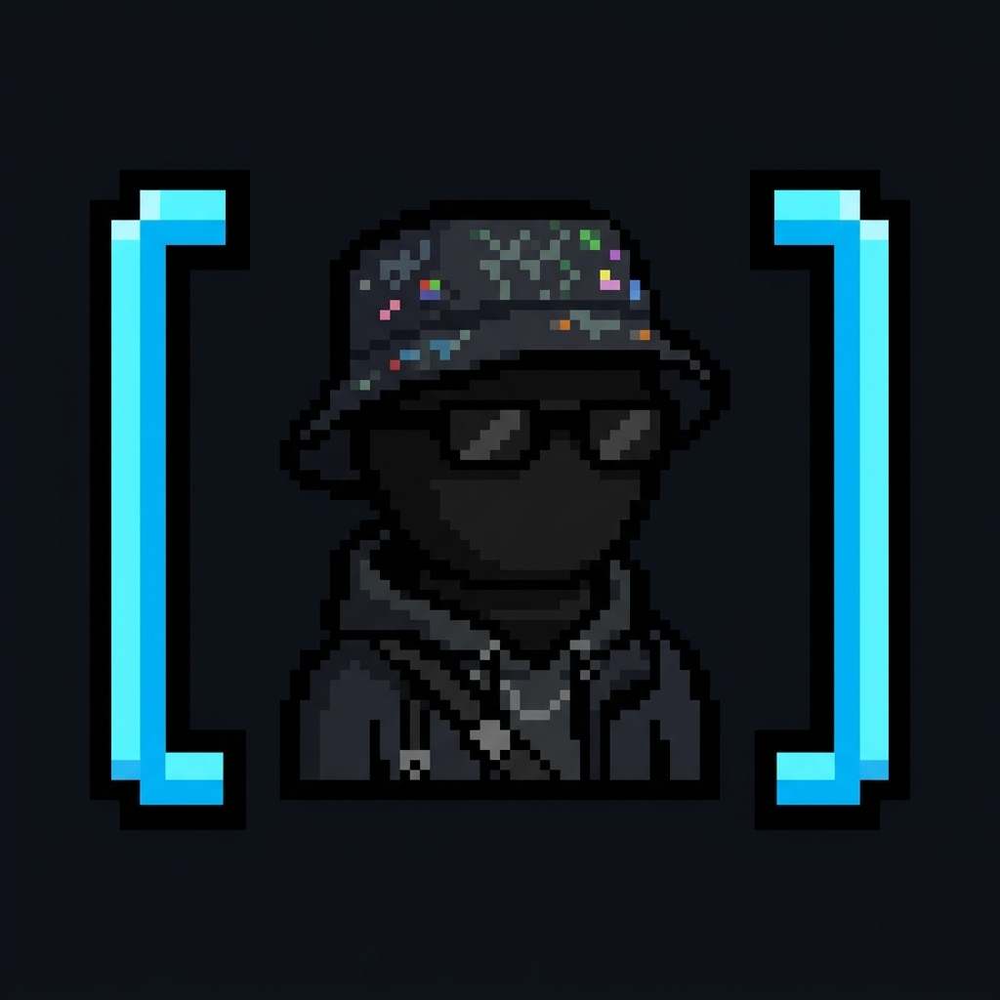

###

  

###

  
  <h1 style="margin: 0; font-size: 2rem;">Hola, mi nombre es Samuel Larios 👋</h1>

- 🎓 Técnico Auxiliar en Ingenería de Software
- 📝 Estudiante en Ingenería de Software

- 💻 Llevo 3 años de experiencia en desarollo web: fronted y backend , con varios proyectos en desarollo de software en python , sql , y arquitectura.

- 📫 Contacto: sl301715@gmail.com
  

 

## Tecnologías Conocidas :

  

 

<picture data-importer="pacman">
  <source media="(prefers-color-scheme: dark)" srcset="https://raw.githubusercontent.com/SamuelLariosR/SamuelLariosR/pacman-output/pacman-contribution-graph-dark.svg?game=pacman">
  <source media="(prefers-color-scheme: light)" srcset="https://raw.githubusercontent.com/SamuelLariosR/SamuelLariosR/pacman-output/pacman-contribution-graph.svg?game=pacman">
  
</picture>

###

